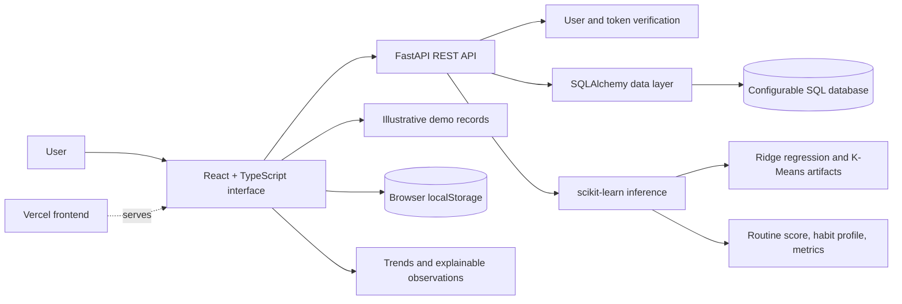

# MindTrace AI

### Understand your digital habits. Recognize stress patterns. Build healthier routines.

**Domain:** AI / Health & Well-being · **Category:** Digital Wellbeing, Behavioral Analytics & Explainable Insights

[](https://react.dev/)
[](https://www.typescriptlang.org/)
[](https://vite.dev/)
[](https://oxc.rs/docs/guide/usage/linter.html)

| Submission link | |
|---|---|
| **Live application** | [techyuvas.vercel.app](https://techyuvas.vercel.app/) |
| **Product demo video** | [Watch on YouTube](https://youtu.be/7YQzM9G8vws?si=gr6qSlCEcz_00y2q) |
| **Source repository** | [github.com/Hussain053/TECHYUVAS](https://github.com/Hussain053/TECHYUVAS) |

## Contents

- [Overview](#overview)
- [Problem statement](#problem-statement)
- [Our solution](#our-solution)
- [Key features](#key-features)
- [System architecture](#system-architecture)
- [AI and analytical approach](#ai-and-analytical-approach)
- [Technology stack](#technology-stack)
- [Project structure](#project-structure)
- [Installation and setup](#installation-and-setup)
- [How to use MindTrace AI](#how-to-use-mindtrace-ai)
- [API reference](#api-reference)
- [Dataset and data handling](#dataset-and-data-handling)
- [Data and privacy](#data-and-privacy)
- [Testing and quality](#testing-and-quality)
- [Deployment and demo](#deployment-and-demo)

## Overview

MindTrace AI helps people reflect on how their digital routines may coincide with changes in self-reported mood, stress, energy, and fatigue. Users can record daily activity summaries and personal check-ins, explore trends, compare recent measures with their own earlier routine, and review practical suggestions connected to visible observations.

The experience is designed for students, working professionals, and anyone who wants a clearer picture of their digital habits. MindTrace combines an interactive React experience, a FastAPI backend, database-backed activity services, and machine-learning-powered routine analysis in one full-stack product.

## Problem statement

Stress and mental fatigue may coincide with changes in day-to-day behavior, including irregular work or study schedules, increased late-night activity, reduced task completion, fewer breaks, and shifts in mood or energy. These patterns are highly personal: the same screen-time total can mean different things for different people, and an isolated measure cannot explain how someone feels.

The project explores how user-consented digital activity summaries and self-reported wellbeing reflections can be brought together to:

- record daily screen time, active hours, tasks, break frequency, and related habits;
- collect mood, perceived stress, energy, and fatigue through a short check-in;
- visualize activity and self-reported wellbeing over time;
- compare a person’s recent records with their own earlier routine;
- explain which available measures changed, using their recorded values; and
- offer practical wellbeing ideas anchored in the user’s observed trends.

## Our solution

MindTrace brings together a polished frontend and dedicated backend services:

1. **Explore** an illustrative demo workspace before entering personal records.
2. **Record** a manually entered activity snapshot and/or a personal check-in.
3. **Build context** from the user’s own historical records where enough data exists.
4. **Review changes** using trend charts and baseline comparisons.
5. **Understand the evidence** behind plain-language observations.
6. **Explore options** through recommendations, flexible goals, and a hypothetical routine simulator.
7. **Replay history** to inspect recorded days and how entries fit along a daily timeline.
8. **Analyze routines with ML** using productivity regression, habit clustering, model metrics, and explainable contributing factors.
9. **Connect to ML services** through FastAPI for routine scoring, habit profiling, and model metrics.

The web experience is built with React and TypeScript. FastAPI exposes the backend services, SQLAlchemy manages relational data, and trained scikit-learn pipelines power routine simulation and habit profiling.

## Key features

### 1. Digital Doppelgänger — interactive daily behaviour replay

The Behaviour Replay presents the selected day’s recorded events on a 24-hour timeline. Users can move through the day with playback and navigation controls, inspect available event details, and view daily summaries. Where check-in values are present, mood, stress, energy, and fatigue overlays can be enabled to provide context alongside the recorded routine. The comparison view can place two recorded dates side by side.

The interactive timeline combines recorded events with optional wellbeing overlays and supports playback, date navigation, event details, daily summaries, and side-by-side date comparisons.

### 2. What-If Routine Simulator

The simulator lets users explore hypothetical daily digital routines using interactive controls and preset scenarios. The backend’s trained regression pipeline estimates a productivity score and returns a reference comparison, contributing factors, and a confidence band. The habit-profiling pipeline complements the estimate with a routine archetype, cluster distance, benchmark averages, and a routine-drift indicator.

Users can adjust the scenario without changing recorded activity history. Simulation inputs and results can also be associated with the current user in the backend.

### 3. Behavioral analytics dashboard

The dashboard and history views organize available records into metrics and trend charts. Depending on what has been entered, these include total and late-night screen use, work/study activity, breaks, tasks, mood, stress, energy, and fatigue. Missing values remain unreported rather than being treated as zero.

### 4. Personal-baseline pattern exploration

MindTrace compares recent activity and self-reported ratings with the same user’s earlier records when there is enough history. Each comparison is accompanied by plain-language context and evidence values. The Routine Variation Index summarizes variation across eligible activity measures.

### 5. Weekly Wellness Report

The report summarizes the latest seven calendar days and compares available averages with the preceding seven-day window. It can include activity days, check-in days, mood and wellbeing ratings, reported sleep and productivity, reported stress contributors, and the highest and lowest recorded stress-rating days. Suggestions are drawn from the existing recommendation logic. The report can be printed or saved as a PDF from the browser.

### 6. Personal habit goals

Users can optionally set screen-time and daily-break goals. Progress is calculated from days with matching recorded activity; unrecorded days are not treated as missed goals. The Demo and Personal workspaces keep their goal settings separate, and the interface can use recent recorded averages as a starting point.

### 7. Personalized recommendations

Optional suggestions are selected by transparent rules from the patterns available in the selected workspace. They can encourage actions such as taking regular breaks or reviewing late-night routines. Each suggestion explains the observation that prompted it. Users may mark a suggestion helpful, dismiss it, or restore it later; feedback does not change analysis results.

### 8. Demo and Personal workspaces

The **Explore demo** workspace contains illustrative sample records for a guided walkthrough. The **Personal** workspace contains entries created by the user. Switching workspaces does not merge their records, charts, goals, or recommendation feedback. Personal entries and preferences persist in the current browser using local storage.

### 9. Daily check-in and activity entry

Users can enter mood, perceived stress, energy, and fatigue on a 1–5 scale. Optional context includes sleep duration, perceived productivity, a selected stress contributor, and a note. Activity is manually entered and can include total screen time, work/study, social media, entertainment, late-night use, breaks, break duration, and completed tasks. User entries can be edited or deleted.

## System architecture

MindTrace uses a full-stack architecture with a responsive browser client, a REST API, relational persistence, and machine-learning inference services. The frontend provides dashboards, check-ins, activity capture, history, recommendations, and interactive routine experiences. The backend handles user-scoped records, health checks, and model-powered routine analysis.



| Component | Current implementation |
|---|---|
| User interface | React 19, TypeScript 6, Vite 8, responsive CSS |
| API layer | FastAPI with interactive OpenAPI documentation |
| Data layer | SQLAlchemy ORM, Alembic migrations, configurable database URL |
| Authentication | User-scoped API dependency with Supabase-compatible JWT verification |
| ML inference | Persisted Ridge regression and K-Means clustering pipelines |
| Data and evaluation | 250-row dataset, model artifacts, and evaluation metrics |
| Frontend persistence | Browser `localStorage` for workspace data and preferences |
| Deployment | Frontend hosted on Vercel; backend can be run as an ASGI service |

## AI and analytical approach

MindTrace combines personalized trend analysis with trained machine-learning models for routine intelligence. The API provides productivity-oriented routine simulation, habit archetype profiling, routine-drift signals, and model evaluation metrics.

### Routine score and habit profiling

- **Regression pipeline:** a training workflow compares a mean baseline, Ridge regression, and Random Forest regression using an 80/20 train-test split, then saves the selected pipeline for inference.
- **Habit clustering:** a standardized K-Means model groups routines into four archetypes, including balanced pacing, high-focus work, leisure-heavy patterns, and late-night routines.
- **Explainable outputs:** simulation responses include a predicted score, comparison with a reference routine, contributing factors, a confidence band, cluster profile, and benchmark averages.
- **Model metrics:** the tracked metrics include MAE, RMSE, and R² for each regression candidate and the selected pipeline.

The checked-in evaluation artifact records a selected Ridge model with an MAE of **8.84**, RMSE of **10.87**, and R² of **0.5867** on a 50-record holdout from the 250-row dataset.

### Personal baseline and recommendations

For each supported measure, the frontend compares the most recent **7 days** with the **21 days before that**, based on the latest available record. A comparison is shown only when that measure has at least **3 recent records** and **5 baseline records**. Activity measures and self-reported ratings are compared independently.

The Routine Variation Index summarizes variation across eligible activity measures. Personalized recommendations use available behavioral patterns to select relevant practical suggestions, and explain the observations that prompted each suggestion.

### Interpreting results responsibly

- **User records** include manually entered activity snapshots and wellbeing check-ins.
- **Personalized insights** compare recent activity and check-in measures with the user’s own historical baseline.
- **Routine simulation** uses trained model artifacts and returns supporting drivers and reference comparisons.
- **Habit profiling** maps a routine to one of four learned behavioral clusters and provides cluster-level context.

## Technology stack

| Technology | Purpose | Why it fits MindTrace AI |
|---|---|---|
| React 19, TypeScript 6, Vite 8 | Frontend application and build tooling | Powers interactive, typed, responsive user experiences |
| CSS, Lucide React, Recharts | Styling, iconography, and visualizations | Delivers polished dashboards and clear trend exploration |
| Python, FastAPI, Uvicorn, Pydantic | Backend API and request validation | Exposes typed REST services with interactive API documentation |
| SQLAlchemy, Alembic, SQLite | Relational persistence and schema migrations | Stores user profiles, daily activities, check-ins, and simulations |
| Scikit-learn, pandas, NumPy, Joblib | Model training, preprocessing, inference, and artifacts | Powers productivity estimation and habit clustering |
| Pytest, HTTPX | Backend testing | Supports API, health, CRUD, and ML test workflows |
| Oxlint, npm | Frontend linting and package management | Supports repeatable frontend development and quality checks |
| Browser `localStorage` | Frontend workspace persistence | Keeps local workspace records and preferences available after refresh |

## Project structure

```text
TECHYUVAS/
├── index.html                 # Application HTML entry point
├── package.json               # Frontend dependencies and commands
├── package-lock.json          # npm dependency lockfile
├── vite.config.ts             # Vite configuration
├── tsconfig*.json             # TypeScript project configuration
├── README.md                  # Project and submission documentation
├── backend/
│   ├── alembic.ini            # Database migration configuration
│   ├── alembic/               # Migration environment and versions
│   ├── app/
│   │   ├── main.py            # FastAPI application and router registration
│   │   ├── config.py          # Environment-backed service configuration
│   │   ├── database.py        # SQLAlchemy engine and session management
│   │   ├── dependencies.py    # User resolution and JWT verification
│   │   ├── models.py          # User, activity, check-in, and simulation models
│   │   ├── schemas.py         # API request and response schemas
│   │   └── routers/           # Health, user, activity, mood, and ML endpoints
│   ├── data/
│   │   └── dataset.csv        # Model training and evaluation dataset
│   ├── ml/
│   │   ├── train.py           # Regression and clustering training pipeline
│   │   ├── inference.py       # Routine simulation and habit profiling
│   │   └── artifacts/         # Saved models and evaluation metrics
│   ├── tests/                 # Backend API, data, and model tests
│   └── requirements.txt       # Python backend dependencies
└── src/
    ├── main.tsx               # React application entry point
    ├── App.tsx                # Main screens, navigation, and interactions
    ├── App.css                # Application component styles
    ├── index.css              # Global styles
    ├── types.ts               # Shared application data types
    ├── assets/                # Local visual assets
    ├── data/
    │   └── demoData.ts        # Illustrative demo activity and check-ins
    └── lib/
        ├── analysis.ts        # Baseline comparison and pattern observations
        ├── api.ts             # Backend health and ML API client
        ├── recommendations.ts # Rule-based suggestion selection
        ├── storage.ts         # Browser-local data load/save and validation
        └── weeklyReport.ts    # Weekly activity and check-in aggregation
```

## Installation and setup

### Prerequisites

- Node.js and npm versions compatible with the Vite version used by the project.
- Python 3.10 or newer and pip for the backend services.
- Git, if cloning the repository.

### Get the project

```bash
git clone https://github.com/Hussain053/TECHYUVAS.git
cd TECHYUVAS
```

### Start the frontend

```bash
npm install
npm run dev
```

Open the local URL printed by Vite.

### Start the backend

From the repository root, create and activate a Python virtual environment, then install the backend requirements:

```bash
python -m venv .venv
# Windows PowerShell
.\.venv\Scripts\Activate.ps1
# macOS/Linux
# source .venv/bin/activate
python -m pip install --upgrade pip
pip install -r backend/requirements.txt pydantic-settings PyJWT
```

Launch the FastAPI application:

```bash
uvicorn backend.app.main:app --reload
```

The API runs at `http://127.0.0.1:8000`; interactive Swagger documentation is available at `http://127.0.0.1:8000/docs`, with ReDoc at `http://127.0.0.1:8000/redoc`.

The database connection is configurable with `DATABASE_URL` and defaults to a local SQLite database. Supabase JWT verification can be configured with `SUPABASE_URL`, `SUPABASE_ANON_KEY`, and `SUPABASE_JWT_SECRET`. `LOCAL_AUTH_DEV_MODE` controls the local development identity behavior.

### Production build

```bash
npm run build
npm run preview
```

The production bundle is written to `dist/`. `npm run preview` serves that bundle locally for a production-style check.

### Available commands

| Command | Purpose |
|---|---|
| `npm run dev` | Start the Vite development server |
| `npm run lint` | Run Oxlint |
| `npm run build` | Run TypeScript project checks and create the Vite production build |
| `npm run preview` | Preview the production build locally |
| `uvicorn backend.app.main:app --reload` | Run the backend API in development |
| `python -m pytest backend/tests -q` | Run the backend test suite |

## How to use MindTrace AI

1. Open the [live application](https://techyuvas.vercel.app/).
2. Start in the demo workspace to explore the illustrative data without adding personal information.
3. Review the dashboard charts and metric cards, then open **History & trends** to inspect recorded dates.
4. Use **Daily check-in** to record mood, stress, energy, fatigue, and any optional context.
5. Use **Activity tracking** to enter a manual summary of screen time, late-night use, breaks, tasks, and related measures.
6. Open **Behavior patterns** to review baseline comparisons and the evidence shown for available observations.
7. Review **Recommendations** for optional suggestions connected to the currently selected records.
8. Open **Behaviour replay** to navigate recorded dates and explore the daily timeline, overlays, and comparisons.
9. Try **Routine simulator** to adjust a hypothetical routine and review its model-generated score, contributing factors, confidence band, and habit archetype.
10. Review **Weekly report** and **My goals** for summaries and optional targets. Use the privacy and data page to understand local storage, export, and data-control options.

Switch to Personal mode to create and revisit personal entries. Saved workspace data remains available after a browser refresh.

## API reference

The FastAPI service exposes interactive OpenAPI documentation at `/docs` and ReDoc at `/redoc`. The primary routes are:

| Method | Route | Purpose |
|---|---|---|
| `GET` | `/` | Service identity and API documentation links |
| `GET` | `/health` | API, database, and model readiness summary |
| `GET` | `/api/v1/users/me` | Retrieve the current user profile |
| `GET`, `POST` | `/api/v1/activities` | List and create or update daily activity records |
| `GET`, `DELETE` | `/api/v1/activities/{activity_id}` | Retrieve or delete an activity record |
| `GET`, `POST` | `/api/v1/moods` | List and create mood check-ins |
| `GET`, `DELETE` | `/api/v1/moods/{checkin_id}` | Retrieve or delete a mood check-in |
| `POST` | `/api/v1/ml/simulate` | Generate a productivity estimate and habit profile |
| `POST` | `/api/v1/ml/profile` | Classify a routine into a behavioral archetype |
| `GET` | `/api/v1/ml/metrics` | Return model evaluation metrics and cluster summaries |

## Dataset and data handling

The backend model dataset is stored in `backend/data/dataset.csv` and contains **250 rows** across **13 columns**. Routine inputs include screen time, active work, social media, entertainment, late-night use, break count and duration, age group, and occupation; the training workflow predicts a productivity score.

The training pipeline uses an 80/20 train-test split, compares a mean baseline with Ridge and Random Forest regression, and saves the selected pipeline for inference. The backend also standardizes behavioral features and applies K-Means clustering to derive four routine archetypes. Evaluation metrics are saved in `backend/ml/artifacts/metrics.json`; trained pipeline artifacts are stored alongside it.

The frontend demo workspace provides illustrative activity and check-in records for exploring the application. User activity entries and check-ins are represented in the backend’s relational models and API, while the frontend also preserves its workspace data and preferences in browser `localStorage`.

## Data and privacy

- Activity summaries and wellbeing check-ins are entered by the user; the application does not require automatic device monitoring.
- The backend associates activity, check-in, and simulation records with user profiles through its API data models.
- Browser workspaces and preferences use `localStorage`, allowing saved frontend data to remain available after a refresh on the same browser.
- The backend uses SQLAlchemy with a configurable `DATABASE_URL`; local development defaults to SQLite.
- Supabase-compatible JWT verification is available through the backend’s authentication dependency and environment configuration.
- Demo records are provided for product exploration, while personal entries are kept in the Personal workspace.
- User-controlled export and data-management options are available in the application.

## Testing and quality

The repository includes frontend lint/build commands and a backend Pytest suite covering health, CRUD, and ML behavior:

```bash
npm run lint
npm run build
python -m pytest backend/tests -q
```

The frontend build runs TypeScript project checks before bundling with Vite. Backend tests use the test configuration in `backend/tests`.

## Deployment and demo

The public submission links are:

- **Live application:** [https://techyuvas.vercel.app/](https://techyuvas.vercel.app/)
- **YouTube demo:** [https://youtu.be/7YQzM9G8vws?si=gr6qSlCEcz_00y2q](https://youtu.be/7YQzM9G8vws?si=gr6qSlCEcz_00y2q)
- **GitHub repository:** [https://github.com/Hussain053/TECHYUVAS](https://github.com/Hussain053/TECHYUVAS)

The frontend uses Vite and produces a static build in `dist/`. The live frontend is available at the Vercel link above. The FastAPI backend runs as an ASGI application and can be deployed to a Python-compatible hosting service with its database URL and authentication settings configured for that environment.
